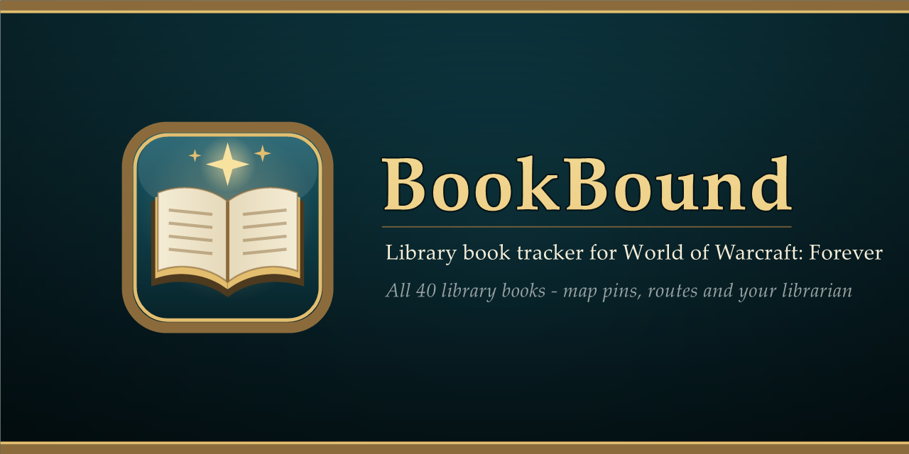

# BookBound: Reports

This is where you report problems with **BookBound**, the library-book tracker addon for
World of Warcraft: Forever. It holds reports only. The addon itself isn't downloaded from here.

## Report a wrong book location

1. In game, type `/books` and open the book.
2. Stand where the book really is (or where the addon sent you), then click
   **Report bad location** or **Found it here**.
3. Open the **Reports** tab, click **Copy**, and press **Ctrl+C**.
4. [Open a location report](../../issues/new?template=location-report.yml), paste the text,
   and submit.

A report includes the book, where the addon expected it, where you were standing, your
client build and the addon build. It never includes account details or character names.

## Report a bug

[Open a bug report](../../issues/new?template=bug-report.yml). Include your addon build,
shown in the main window title and at the bottom of Settings.
